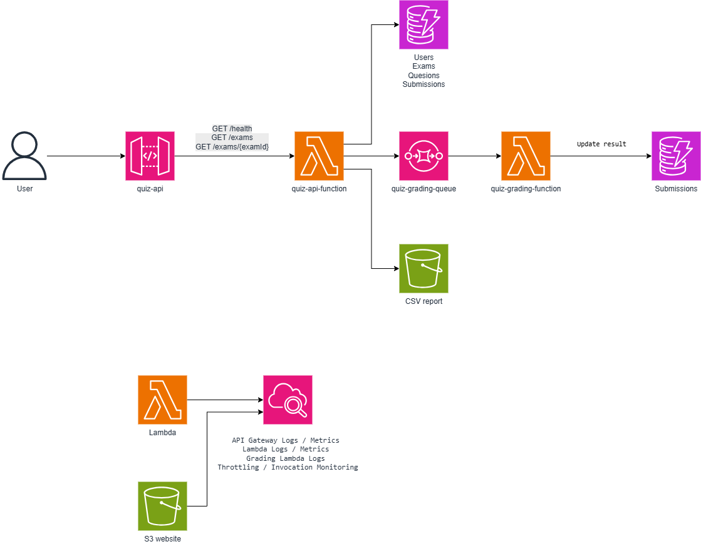

# Serverless Online Quiz Platform

Đồ án môn học Điện toán đám mây.

Hệ thống thi trắc nghiệm trực tuyến được triển khai theo kiến trúc
serverless trên AWS Learner Lab.

## AWS Services

- Amazon API Gateway
- AWS Lambda
- Amazon DynamoDB
- Amazon SQS
- Amazon S3
- Amazon CloudWatch
- Amazon VPC
- AWS IAM LabRole

## Architecture

## Week 1 Progress

- [x] Research AWS services
- [x] Design serverless architecture
- [x] Create VPC
- [x] Configure IAM LabRole
- [x] Create S3 report bucket
- [x] Create DynamoDB tables
- [x] Create SQS grading queue
- [x] Create Lambda functions
- [x] Create API Gateway
- [x] Test GET /health
- [x] Test GET /exams/{examId}
- [x] Verify CloudWatch logs

## Current API

### Health Check

GET /health

### Get Exam

GET /exams

GET /exams/{examId}

## Deployment Environment

AWS Learner Lab  
Region: us-east-1
