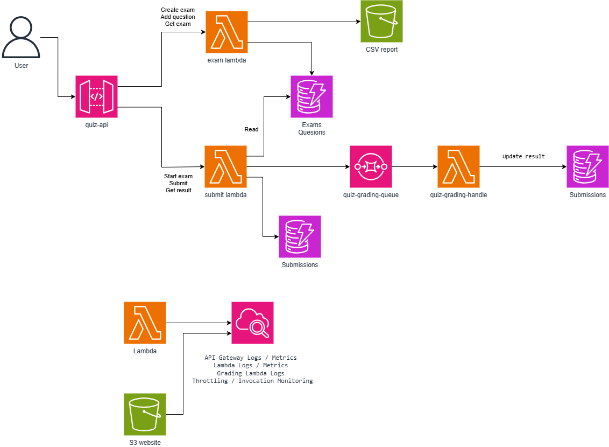
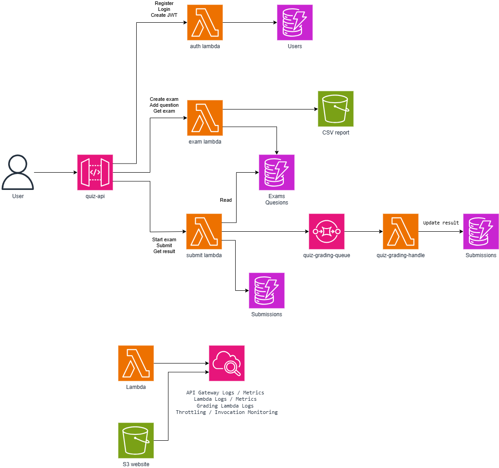

# Serverless Online Quiz Platform

Đồ án môn học Điện toán đám mây.

Hệ thống thi trắc nghiệm trực tuyến được triển khai theo kiến trúc
serverless trên AWS Learner Lab.

## AWS Services

- Amazon API Gateway
- AWS Lambda
- Amazon DynamoDB
- Amazon SQS
- Amazon S3
- Amazon CloudWatch
- Amazon VPC
- AWS IAM LabRole

## Week 1 Progress

### Architecture


- [x] Research AWS services
- [x] Design serverless architecture
- [x] Create VPC
- [x] Configure IAM LabRole
- [x] Create S3 report bucket
- [x] Create DynamoDB tables
- [x] Create SQS grading queue
- [x] Create Lambda functions
- [x] Create API Gateway
- [x] Test GET /health
- [x] Test GET /exams/{examId}
- [x] Verify CloudWatch logs

## Week2 Progress

### Architecture



- [x] **Exam Management:** Build APIs to create exams, add questions, and fetch exam details using AWS Lambda and DynamoDB.
- [x] **Start Exam:** Initialize exam sessions, randomize question order, and return exam content to candidates.
- [x] **Time Limit:** Validate exam duration on the backend and reject late submissions.
- [x] **Submit Exam:** Receive answers, store records in the `Submissions` table, and push grading requests to Amazon SQS.
- [x] **Auto Grading:** Process grading asynchronously using a Grading Lambda triggered by SQS.
- [x] **Get Result:** Retrieve correct answers count, total questions, and final scores from DynamoDB.
- [x] **API Testing:** Test endpoints with Postman and monitor execution via AWS CloudWatch Logs.

## Week 3 Progress

### Architecture – JWT Authentication, RBAC & Monitoring



> **Architecture update:** Week 3 extends the Week 2 workflow with an **Auth Lambda**, **JWT Lambda Authorizer**, and **DynamoDB Users** table. Keep the SQS → Grading Lambda → Submissions flow from Week 2. Export the revised diagram as `architecture/week3-architecture.png` to display it here.

- [x] **Student Registration & Login:** Implement `POST /auth/register` and `POST /auth/login` with an Auth Lambda and a `Users` table in DynamoDB.
- [x] **JWT Authentication:** Generate signed JWTs (HS256) containing `sub`, `role`, `iat`, `exp`, `iss` and `aud`, without Amazon Cognito.
- [x] **Secure Password Storage:** Store salted password hashes instead of plaintext passwords. Admin accounts are provisioned separately, not through public registration.
- [x] **Lambda Authorizer:** Validate Bearer tokens on protected API Gateway routes and pass verified `userId`/`role` claims to backend Lambdas.
- [x] **Role-Based Access Control (RBAC):** Restrict exam/question management to Admin and exam attempts/results to Student.
- [x] **Submission Ownership:** Use the authenticated Student ID when creating attempts and check ownership before submission/result access.
- [x] **Integration Debugging:** Update Exam and Attempt Lambda handlers to enforce RBAC and check behavior using Postman.
- [x] **CloudWatch Troubleshooting:** Use Lambda logs to inspect runtime, timeout and integration issues during deployment.
- [ ] **Attach final evidence:** Add screenshots for expired-token rejection, CloudWatch metrics, and a completed grading result after verifying each in AWS Learner Lab.

### Authentication & Authorization Workflow


JWT Authorizer checks token validity, while **backend Lambdas enforce role and submission-ownership rules**. Login and registration routes are public; other quiz routes require a valid token. Exam API and Attempt API may be separate API Gateways; each protected route must have its authorizer configured.

### Role Permissions (RBAC)

| Endpoint | Admin | Student |
|---|---|---|
| `GET /exams` | Allowed | Allowed |
| `GET /exams/{examId}` | Allowed | Allowed |
| `POST /exams` | Allowed | `403 Forbidden` |
| `POST /exams/{id}/questions` | Allowed | `403 Forbidden` |
| `POST /exams/{id}/start` | `403 Forbidden` | Allowed |
| `POST /submissions/{id}/submit` | `403 Forbidden` | Allowed (own submission) |
| `GET /submissions/{id}/result` | `403 Forbidden` | Allowed (own submission) |

> The table describes permissions for otherwise valid requests. Business logic can also reject a request because an exam/submission does not exist, an attempt has expired, or grading is not yet finished.

### Testing & Monitoring

- **Postman:** Test successful login, missing/invalid tokens, forbidden Student actions, forbidden Admin actions and submission ownership.
- **Expired JWT negative test:** Obtain a short-lived JWT; confirm access before expiration, then confirm the **same token** is rejected after expiration. Keep actual response screenshots for the advisor's review.
- **Asynchronous grading:** Student submits answers → Attempt Lambda stores `SUBMITTED` → SQS triggers Grading Lambda → DynamoDB is updated to `COMPLETED` with a score. A `200 OK` response with `SUBMITTED` alone does **not** confirm grading is complete.
- **CloudWatch:** Review Lambda `Invocations`, `Errors`, `Duration`, `Throttles`, and API Gateway 4xx/5xx where enabled; retain actual metric/log screenshots. Test concurrency/throttling under the Lab limits in Week 4.
- **Security:** Never commit `JWT_SECRET`, Admin passwords, access tokens, `admin-item.json`, or DynamoDB password hashes/salts.

## Current API

Public routes (`Authorization: NONE`):

```http
GET  /health
POST /auth/register
POST /auth/login
```

Protected routes (request header: `Authorization: Bearer <accessToken>`):

```http
GET  /exams
GET  /exams/{examId}
POST /exams
POST /exams/{id}/questions
POST /exams/{id}/start
POST /submissions/{id}/submit
GET  /submissions/{id}/result
```

The Exam API and Attempt API can have **different API Gateway base URLs**. Use the corresponding base URL for each route in Postman.

## Deployment Environment

AWS Learner Lab  
Region: us-east-1
