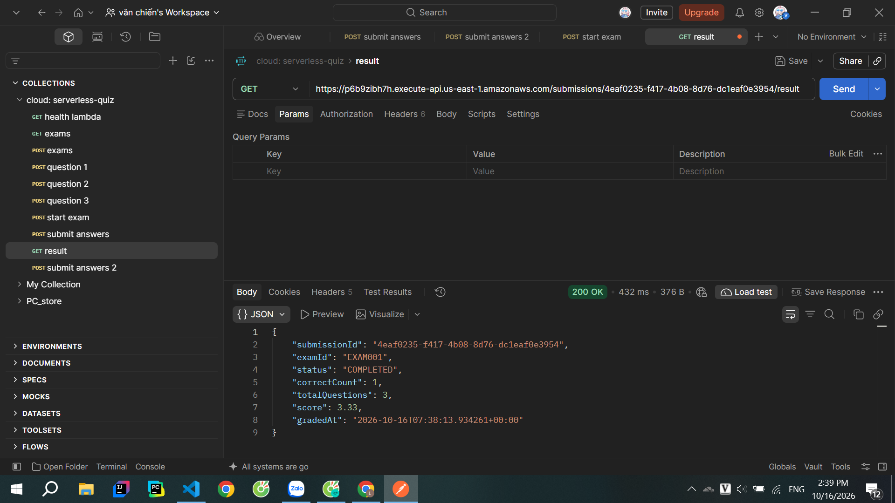

# Tuần 2 – Kết quả kiểm thử chức năng (Test Results)

> **Trạng thái:** Đã kiểm thử chức năng lõi; **chưa kiểm thử tải 200 người dùng đồng thời**.

## 1. Mục tiêu và phạm vi

Theo yêu cầu Tuần 2, nhóm triển khai các chức năng lõi và kiểm thử từng thành phần thực tế trên AWS Learner Lab. Việc ghi kết quả giúp xác minh luồng đề thi → lượt thi → nộp bài → SQS → chấm điểm → xem điểm.

Bảng DynamoDB sử dụng: `Users` (`userId`), `Exams` (`examId`), `Questions` (`examId` + `questionId`), `Submissions` (`submissionId`).

## 2. Danh sách API đã kiểm thử

| Method | Endpoint | Mục đích | Trạng thái kiểm thử |
|---|---|---|---|
| GET | `/health` | Health check | Hoạt động |
| POST | `/exams` | Tạo đề thi | Hoạt động |
| GET | `/exams` | Lấy danh sách đề | Hoạt động (`200 OK` đã xác nhận) |
| GET | `/exams/{id}` | Lấy thông tin đề | Hoạt động |
| POST | `/exams/{id}/questions` | Thêm câu hỏi | Hoạt động |
| POST | `/exams/{id}/start` | Bắt đầu thi, xáo câu hỏi | Hoạt động |
| POST | `/submissions/{id}/submit` | Nộp bài, đưa vào SQS | Hoạt động |
| GET | `/submissions/{id}/result` | Lấy kết quả chấm | Hoạt động (`200 OK`) |

**Ghi chú:** `id` của route Submit/Result là `submissionId` thực tế. Phần thân Submit phải có `answers` là JSON object, với khóa là `questionId`, ví dụ:

```json
{
  "answers": {
    "QUESTION001": "A",
    "QUESTION002": "B",
    "QUESTION003": "C"
  }
}
```

`QUESTION001`–`QUESTION003` là ví dụ; khi test phải thay bằng `questionId` mà Start Exam trả về.

## 3. Kết quả End-to-End (E2E)

Thí nghiệm đã ghi nhận:

| Thuộc tính | Giá trị |
|---|---|
| `submissionId` | `3e7aa696-d7b5-4c19-b1de-eedd2d1f85db` |
| `examId` | `EXAM001` |
| `status` | `COMPLETED` |
| `correctCount` | `1` |
| `totalQuestions` | `3` |
| `score` | `3.33` |
| `gradedAt` | `2026-10-16T05:35:53.674464+00:00` |

Response thực tế từ Get Result:

```json
{
  "submissionId": "3e7aa696-d7b5-4c19-b1de-eedd2d1f85db",
  "examId": "EXAM001",
  "status": "COMPLETED",
  "correctCount": 2,
  "totalQuestions": 3,
  "score": 6.67,
  "gradedAt": "2026-10-16T05:35:53.674464+00:00"
}
```



Công thức chấm điểm: `score = round(correctCount / totalQuestions × 10, 2)`.

Với 1/3 câu đúng: `round(1 / 3 × 10, 2) = 3.33`.

## 4. Kiểm thử trường hợp đặc biệt (Negative/Edge Tests)

| Test case | Cách thực hiện | Kết quả quan sát được | Đánh giá |
|---|---|---|---|
| Nộp lại bài đã `COMPLETED` | Sửa `answers`, gửi lại Submit, gọi Get Result | Submit vẫn **HTTP 200**; kết quả và điểm giữ nguyên | Đạt về toàn vẹn dữ liệu; có thể chuẩn hóa thông báo API sau |
| Nộp quá hạn | Start đề 1 phút, chờ hết hạn rồi Submit | Hệ thống từ chối bài nộp quá thời gian | Đạt |
| Mã đề thi không tồn tại | `POST /exams/INVALID/start` | API báo không tìm thấy đề | Đạt |
| `questionId` sai | Submit ID không thuộc lượt thi | API từ chối dữ liệu không hợp lệ | Đạt |
| Trả lời sai cả 3 câu | Tạo lượt thi mới, trả lời sai toàn bộ | Điểm bằng 0 | Đạt |
| Không lộ đáp án | Kiểm tra JSON của Start Exam | Không có trường `correctAnswer` | Đạt |

## 5. Kiểm tra từng thành phần trên AWS

| Thành phần | Nội dung xác minh | Kết quả |
|---|---|---|
| API Gateway | Route và Lambda integration phản hồi đúng | Đạt |
| Lambda Exam Handler | Quản lý đề/câu hỏi | Đạt |
| Lambda Attempt Handler | Bắt đầu thi, xác thực request và nộp bài | Đạt |
| DynamoDB `Exams`, `Questions` | Đọc đề và câu hỏi | Đạt |
| DynamoDB `Submissions` | Lưu lượt thi, trạng thái, số câu đúng, điểm | Đạt |
| SQS + Grading Lambda | Xử lý bất đồng bộ và trả kết quả `COMPLETED` | Đạt thông qua kết quả E2E; lưu thêm ảnh trigger/log để làm minh chứng |
| CloudWatch Logs | Hỗ trợ phát hiện nguyên nhân lỗi | Đã sử dụng khi sửa lỗi |

## 6. Lỗi gặp phải và cách xử lý

| Sự cố | Nguyên nhân và cách khắc phục |
|---|---|
| `400 Invalid JSON` ở Lambda đọc đề | `Decimal` từ DynamoDB chưa được `json.dumps` hỗ trợ; bổ sung chuyển đổi `Decimal` sang `int`/`float` |
| Start Exam không nhận thời gian thi | Item `EXAM001` dùng thuộc tính `duration`; Lambda yêu cầu `durationMinutes`; bổ sung trường `durationMinutes` kiểu Number |
| `500 ResourceNotFoundException` khi Start Exam | Lambda ghi vào tên bảng DynamoDB chưa khớp; kiểm tra biến môi trường, dùng bảng `Submissions` trong `us-east-1` |
| Sai khóa bảng bài làm | Bảng `Submissions` sử dụng khóa `submissionId`; cập nhật thao tác `PutItem`/`GetItem`/`UpdateItem` cho phù hợp |
| Submit với `"answers": "A"` | `answers` phải là JSON object `{ "questionId": "A" }`, không phải chuỗi đơn |

## 7. Kết luận và phần chưa thực hiện

Các chức năng lõi đã chạy qua kiểm thử thực tế: tạo/lấy đề, thêm câu hỏi, bắt đầu thi, nộp bài, chấm điểm tự động và lấy kết quả. Kết quả mẫu là **1/3 câu đúng, 3.33/10 điểm, trạng thái `COMPLETED`**.

Các nội dung **chưa xem là hoàn thành trong Tuần 2**: JWT Authentication, phân quyền Admin/Student, giám sát/alert nâng cao, xuất CSV lên S3, bài kiểm thử tải 200 người dùng đồng thời và đo Lambda throttling với giới hạn 10 concurrent executions. Những phần này thuộc kế hoạch Tuần 3–4.
