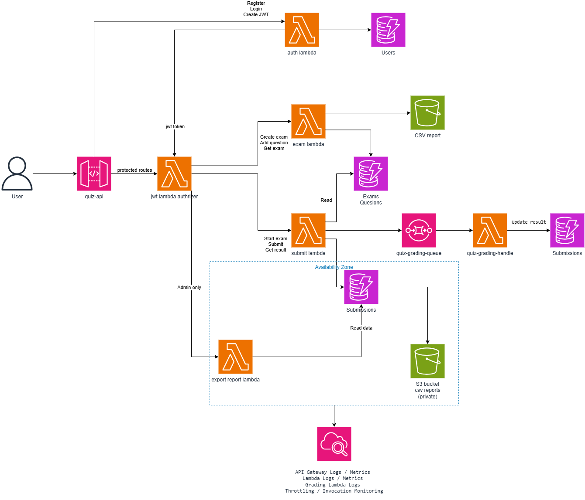

# Tuần 4 – Kiểm thử tổng thể, tối ưu chi phí và hoàn thiện đồ án Serverless Quiz Platform

**Đề tài:** Nền tảng thi trắc nghiệm trực tuyến serverless (Capstone)  
**Môi trường:** AWS Academy Learner Lab  
**Region:** `us-east-1`  
**Repository:** https://github.com/VanChien11-02/serverless-quiz-platform-aws  
**Tài liệu kế thừa:** `docs/week2/cost-estimation.md`, `docs/week3/week3-report.md`, `docs/week3/week3-test-results.md`.

## 1. Công việc thực hiện và kế thừa từ các tuần trước

Tuần 1 xây dựng nền tảng và thiết kế serverless; Tuần 2 triển khai quản lý đề thi, bắt đầu thi, nộp bài, SQS và chấm điểm bất đồng bộ; Tuần 3 bổ sung JWT tự cài đặt, Lambda Authorizer, RBAC Admin/Student và đã được GVHD duyệt.

Trong bộ minh chứng Tuần 4 có bằng chứng thực tế cho các hạng mục sau:

- AWS Console hiển thị Lambda `quiz-export-report`.
- Postman gọi `POST /reports/export` với một request Admin và nhận `200 OK`; response trả về bucket và object key.
- Một request Student tới route export nhận `403 Forbidden` với thông báo `Admin role required`.
- S3 có object CSV, và nội dung object được mở bằng bảng tính.
- Locust đã được chạy ở các mức 10, 50, 100 và 200 virtual users.
- Đã mở kiểm tra quota Lambda, cấu hình concurrency của Export Lambda, CloudWatch `ConcurrentExecutions`/`Throttles` và trang Billing and Cost Management.

Một số mục vẫn chưa được chứng minh đầy đủ: kiểm tra RBAC trên cùng API base URL, đối chiếu số dòng CSV, chạy test tải đến trạng thái kết thúc và lưu report cuối, áp dụng giới hạn 10 concurrency, đối chiếu metrics đúng thời gian load test, số chi phí chính xác, cleanup, worklog giờ thực tế và video demo.

## 2. Kiến trúc hệ thống (System Architecture)

Hệ thống kế thừa API Gateway, Auth Lambda, JWT Lambda Authorizer, Exam/Attempt Lambda, DynamoDB (`Users`, `Exams`, `Questions`, `Submissions`), SQS Grading Queue, Grading Lambda và CloudWatch.

### Luồng 1 – JWT/RBAC (kế thừa Tuần 3)

`Postman/User → API Gateway → JWT Lambda Authorizer → Exam/Attempt Lambda`.

### Luồng 2 – Làm bài và chấm điểm bất đồng bộ

`Student → Attempt Lambda → DynamoDB Submissions (SUBMITTED) → SQS → Grading Lambda → DynamoDB Submissions (COMPLETED, score) → Get Result`.

### Luồng 3 – Xuất báo cáo CSV

`Admin Bearer JWT → POST /reports/export → quiz-export-report → DynamoDB Submissions → S3 CSV`.

### Luồng 4 – Load test và giám sát

`Locust (10 → 50 → 100 → 200 VU) → API Gateway → Lambda/DynamoDB/SQS`

## 3. Kết quả kiểm thử tổng thể

### 3.1. Export CSV và phân quyền

| Kiểm thử | Kết quả quan sát | Minh chứng |
|---|---|---|
| Lambda `quiz-export-report` | Function hiện diện trên AWS Console | [01-export-lambda.png](../../screenshots/week4/01-export-lambda.png) |
| Admin `POST /reports/export` | `200 OK`, khoảng `2.81 s`; `examId=EXAM001`; `rows=3`; bucket `serverless-quiz-report-team-2026`; key `reports/EXAM001/results-20261028T033915Z-51a0bfbf.csv` | [02-export-api-admin-200.png](../../screenshots/week4/02-export-api-admin-200.png) |
| Student `POST /reports/export` | `403 Forbidden`, `Admin role required` | [03-export-api-student-403.png](../../screenshots/week4/03-export-api-student-403.png) |
| Object S3 | Object CSV hiện diện, dung lượng `522.0 B`, `Standard` | [04-s3-csv-object.png](../../screenshots/week4/04-s3-csv-object.png) |
| CSV content | Các cột kết quả hiển thị; dòng dữ liệu nhìn thấy có `COMPLETED`, điểm `6.67`/`3.33`; không thấy cột `answerKey` | [05-s3-csv-content.png](../../screenshots/week4/05-s3-csv-content.png) |

### 3.2. Kiểm thử tải Locust

Các ảnh được chụp khi giao diện Locust còn hiển thị `RUNNING`. Bảng dưới ghi lại đúng số trong hàng `Aggregated`; `Current RPS` là giá trị tại thời điểm chụp, không phải throughput trung bình của toàn bộ một bài test đã dừng.

| Virtual users | Requests | Failures | Failure rate | Current RPS | P95 (ms) | P99 (ms) | Average response (ms) |
|---:|---:|---:|---:|---:|---:|---:|---:|
| 10 | 110 | 0 | 0.00% | 4.1 | 3300 | 3900 | 764.53 |
| 50 | 700 | 50 | 7.14% | 7.9 | 3100 | 3200 | 591.92 |
| 100 | 1400 | 100 | 7.14% | 7.5 | 3100 | 3200 | 589.02 |
| 200 | 2792 | 194 | 6.95% | 9.6 | 3200 | 3300 | 577.07 |

Minh chứng: [10 VU](../../screenshots/week4/06-locust-10.png), [50 VU](../../screenshots/week4/07-locust-50.png), [100 VU](../../screenshots/week4/08-locust-100.png), [200 VU](../../screenshots/week4/09-locust-200.png), [charts](../../screenshots/week4/10-locust-charts.png), [failures](../../screenshots/week4/11-locust-failures.png).

## 4. Giới hạn Lambda đồng thời và CloudWatch

Ảnh CloudShell chạy `aws lambda get-account-settings --region us-east-1` cho thấy:

- `AccountLimit.ConcurrentExecutions = 400`.
- `AccountLimit.UnreservedConcurrentExecutions = 400`.
- `AccountUsage.FunctionCount = 12`.

 Minh chứng: [quota](../../screenshots/week4/13-lambda-account-quota.png), [concurrency config](../../screenshots/week4/14-lambda-concurrency-config.png), [ConcurrentExecutions](../../screenshots/week4/15-cloudwatch-concurrent-executions.png), [Throttles](../../screenshots/week4/16-cloudwatch-throttles.png).

## 5. Chi phí và dọn dẹp tài nguyên

Ảnh Billing and Cost Management hiển thị biểu đồ theo tháng từ May đến Oct 2026 và các nhãn chi phí làm tròn về `$0.00`; ảnh không hiển thị bảng chi tiết hoặc bộ lọc chi phí riêng cho project. Vì vậy chưa có căn cứ để nêu tổng chi phí thực tế chính xác. Báo cáo Tuần 2 có dự toán khoảng `0.0069 USD` cho kịch bản giả định 200 lượt thi; đây là **ước tính**, không phải hóa đơn thực tế.

## 6. Đánh giá kết quả

**Đã có bằng chứng:** Lambda export tồn tại; một request Admin trả 200 với S3 key; object CSV tồn tại và đọc được; một request Student trả 403; Locust đã chạy ở các mức 10/50/100/200 VU; đã kiểm tra quota Lambda, metric concurrency/throttles và trang Billing.

## 7. Minh chứng và tài liệu

- Sơ đồ: [architecture/week4-architecture.png](../../architecture/week4-architecture.png).
- Bộ ảnh: `screenshots/week4/01` đến `17`.
- Kết quả kiểm thử chi tiết: [week4-test-results.md](week4-test-results.md).
- Chi phí: [cost-report.md](cost-report.md).
- Cleanup: [cleanup.md](cleanup.md).
- Nhật ký công việc: [worklog.md](worklog.md).
- Báo cáo nộp GVHD: [week4-report-submission.md](../../week4-report-submission.md).
